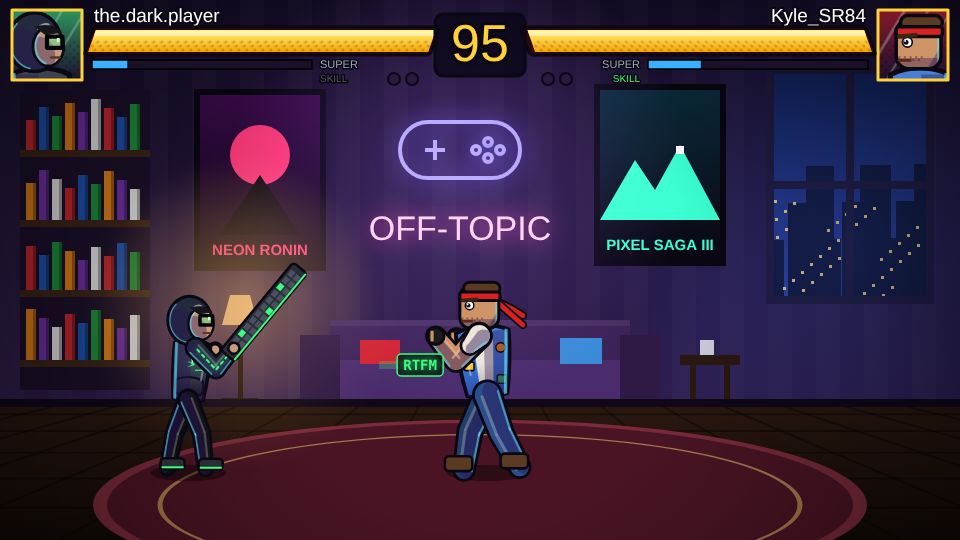
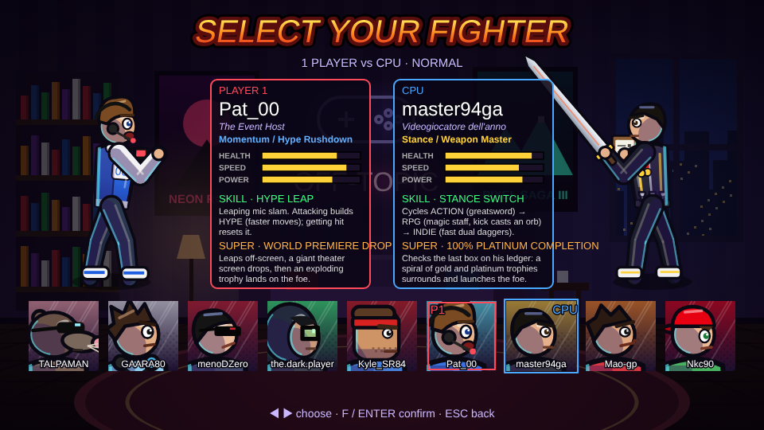

# 🥊 Forum Fighters — IGN Italia Community Edition

A small Street Fighter–style fighting game starring members of the IGN Italia forum.
It runs in the browser with plain JavaScript and canvas: no libraries, no build step, no image files.

### ▶️ [Play it on GitHub Pages](https://stefanomartin.github.io/IGNfight/)



## Features

- **1 player vs CPU** (Easy / Normal / Hard) or **2 players** on the same keyboard
- Gamepad support (up to 2 controllers)
- Character select, best-of-3 rounds, 99-second timer, K.O. and Time Over
- Punches, kicks, crouching attacks, sweeps, air attacks and blocking
- A **skill** on a cooldown and a **super** that uses a full meter for every fighter
- Combos: a punch or kick that lands can be cancelled into a skill or super
- Chiptune music, sound effects and an announcer voice (browser speech synthesis)

## Controls

| Action | Player 1 | Player 2 | Gamepad |
|---|---|---|---|
| Move / jump / crouch | `W` `A` `S` `D` | Arrow keys | Stick / D-pad |
| Punch | `F` | `,` or `Num1` | X |
| Kick | `G` | `.` or `Num2` | A |
| Skill | `H` | `/` or `Num3` | B |
| Super (meter at 100%) | `J` | `Right Shift` or `Num0` | Y / RB |
| Block | Hold away from the opponent | same | same |

`P` / `Esc` pause · `Q` (while paused) back to character select · `M` music on/off

> Click the game once if the keyboard doesn't respond.

## The roster



| Fighter | Style | Skill | Super |
|---|---|---|---|
| **Talpaman** | All-Rounder / Trap Setter | **Burrow**: digs underground and pops up behind the opponent with an uppercut | **Thread Lock & Meme Flood**: a padlock stuns the foe, then a wave of *Immagini Divertenti* juggles them |
| **Gaara80** | Rushdown / Glass Cannon | **Instant Reply**: a lightning-fast dash punch | **100,000 Post Barrage**: a 50-hit keyboard flurry finished by a *TOP POSTER* uppercut. His floating post counter goes up with every hit |
| **menoDZero** | Heavy Counter / Stance | **Parry Stance**: catches an attack and answers with a counter-slash | **Dramatic Exit**: *"Lascio il forum. Per sempre."* Hit him while he walks away and he teleports back: *"Sono tornato!"* |
| **the.dark.player** | Zoner / Technical | **Code Throw**: hurls a line of raw code. His mechanical keyboard gives his attacks extra reach | **Wall of Text**: a towering wall of paragraphs slides across and crushes the foe into the corner |
| **Kyle_SR84** | Slow & Heavy Grappler | **Arcade Slam**: unblockable command grab. Super armor on standing punches and kicks | **Backlog Avalanche**: a rift drops his entire unplayed library on your head |
| **Pat_00** | Momentum / Hype Rushdown | **Hype Leap**: leaping mic slam. Staying on the offensive builds **HYPE** (T-2 → T-1 → LIVE!), which makes his moves and walk faster; getting hit resets it | **World Premiere Drop**: leaps off-screen, a giant theater screen drops behind the arena, then an exploding trophy lands on the foe |
| **master94ga** | Stance / Weapon Master | **Stance Switch**: cycles ACTION (greatsword: slow, long reach, heavy), RPG (magic staff: his kick casts an orb) and INDIE (dual daggers: very fast) | **100% Platinum Completion**: ticks the last box on his ledger and a spiral of gold and platinum trophies surrounds and launches the foe |
| **Mao-gp** | Mix-up / Bait-and-Punish | **Feint Dash**: invulnerable dash into a GPU-shield bash, or a retreating feint if you hold back. Punishing a missed attack deals ×1.5 | **3,000-Post Flame War**: a single spark erupts into a pillar of forum fire that traps the foe under a rain of angry replies |
| **Nkc90** | Agile Aerial Fighter | **Blade Beam**: energy crescent from his controller blade, also usable in mid-air. Has a double jump and floaty jumps | **Direct Shadow-Drop**: a snap of the fingers and a giant red DIRECT banner slams down out of nowhere |

More fighters coming soon.

## Run it locally

No build step and no server needed: clone or download the repo and open `index.html` in a modern browser (Chrome, Edge or Firefox).

## Project structure

```
index.html                  entry point: loads the CSS and the scripts in order
css/style.css               page layout (the game itself is drawn on a canvas)
js/
  core/
    utils.js                constants (screen size, ground, walls) and math helpers
    input.js                keyboard + gamepad mapping
    audio.js                synthesized sound effects, music loop, announcer voice
  render/
    draw-helpers.js         canvas primitives (outlined shapes, titles, text wrap)
    fighter-render.js       poses -> skeleton -> drawn body, portraits
    stage.js                the living-room background
  game/
    registry.js             registerFighter() and the normal moves (punch, kick, ...)
    state.js                game state, Fighter class, particles
    combat.js               hitboxes, hits, blocking, armor, K.O., skill/super entry
    projectiles.js          generic projectile system
    fighter.js              per-frame fighter state machine and physics
    ai.js                   CPU opponent
    effects.js              particles, floating text, speech bubbles
  characters/               one file per fighter: stats, look, poses, skill, super
    talpaman.js
    gaara80.js
    menodzero.js
    the-dark-player.js
    kyle-sr84.js
    pat-00.js
    master94ga.js
    mao-gp.js
    nkc90.js
  scenes/
    title.js  select.js  fight.js  result.js  hud.js
  main.js                   fixed 60 fps update loop
docs/                       screenshots used in this README
```

The scripts are plain `<script>` tags (not ES modules) so the game also works when opened straight from disk. Their order in `index.html` matters: each file only uses what the files above it define.

## Adding a new fighter

1. Copy one of the files in `js/characters/` (for example `gaara80.js`) to `js/characters/<new-name>.js`.
2. Change the data in `registerFighter({...})`:
   - **identity**: `id` (unique), `name`, `spoken` (for the announcer), `tag`, `style`, `win` quotes
   - **stats**: `hp`, `spd`, `jump`, `kbm` (knockback taken), `pow`, `frameData` (speed / damage / reach of normal moves)
   - **look**: colours and the `torso`, `head`, `hand`, `foot` drawing functions (plus optional `behind`, `armDeco`, `front`)
   - **moves**: `skillMove(f, o, t, d)` and `superMove(f, o, t, d)` run once per frame while the move is active (`t` = frame number, `d` = scratch data); call `toIdle(f)` when done
   - **ai**: preferred `range`, aggression, and when to use the skill and super
   - **optional hooks** for special mechanics (see the comment at the top of `js/game/registry.js`): e.g. `haste` (Pat's hype), `movesFor` (master94ga's stances), `doubleJump` / `airSkill` (Nkc90), `punishBonus` (Mao-gp)
3. Add `<script src="js/characters/<new-name>.js"></script>` to `index.html` next to the other characters. The select screen adapts to the roster size automatically.

---

A fan-made, non-commercial project for fun within the IGN Italia community. Not affiliated with or endorsed by IGN.
